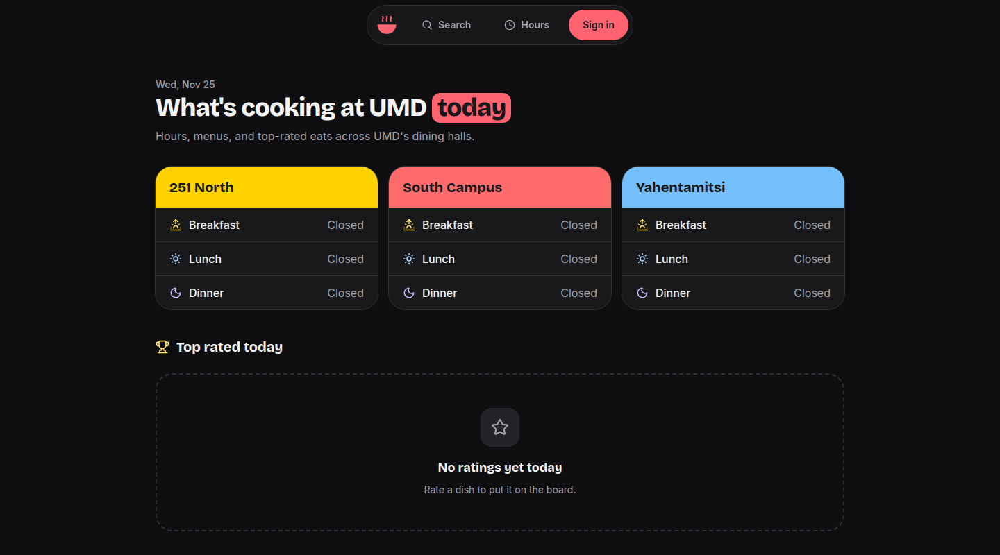
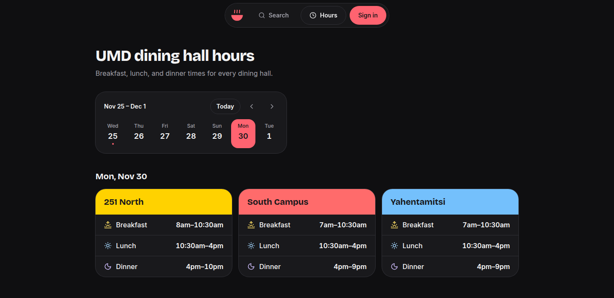
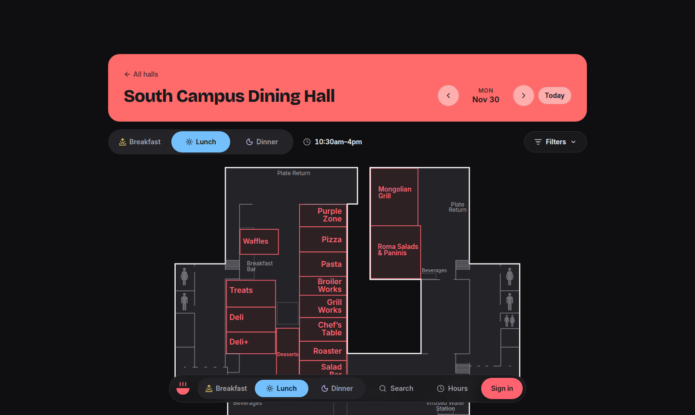
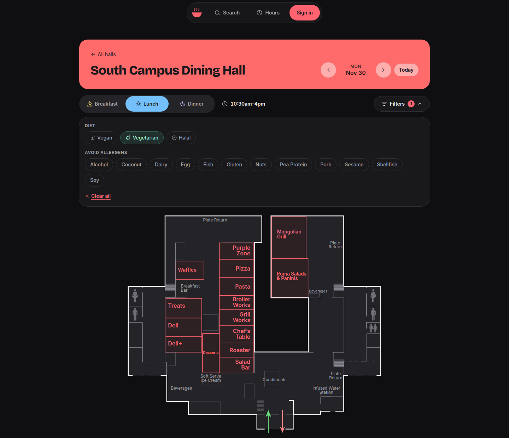
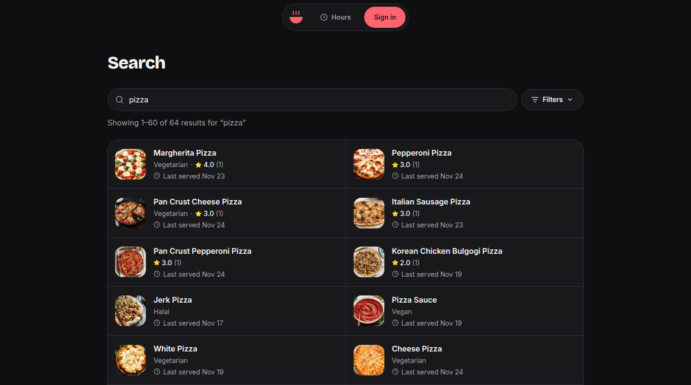
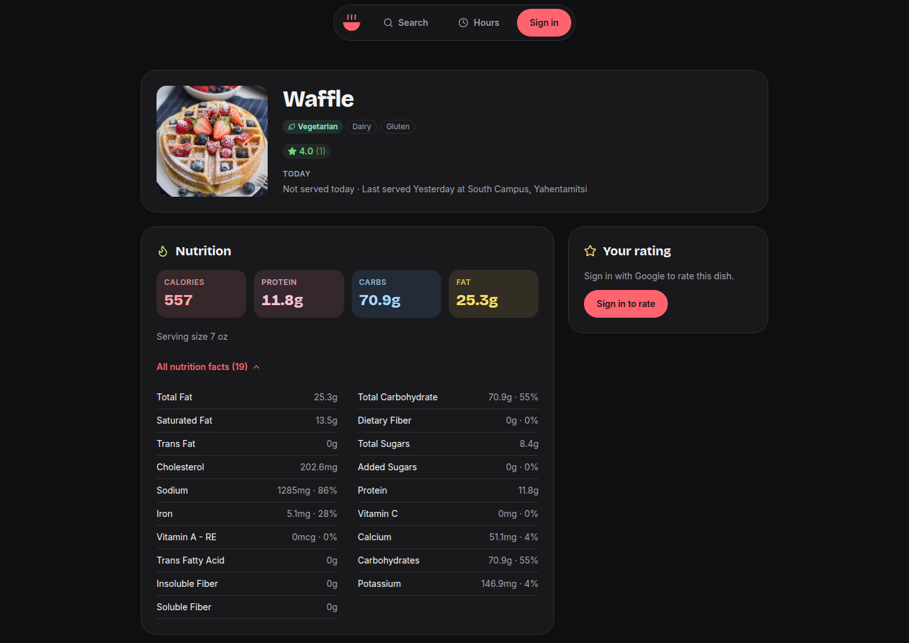
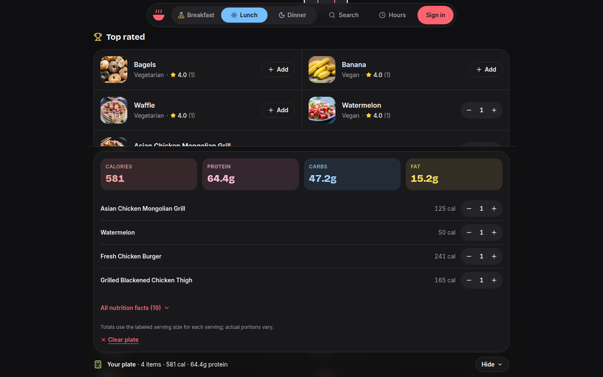
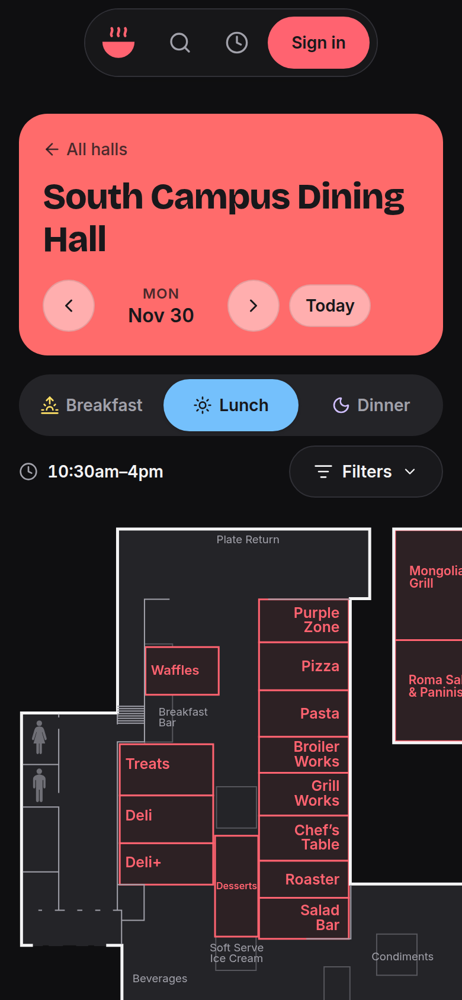

# TerpsDining

[](https://github.com/sbharga/terpsdining/actions/workflows/ci.yml)

TerpsDining shows menus, hours, nutrition, and ratings for the University of Maryland's dining halls. Visit [terpsdining.app](https://terpsdining.app).



## Features

### Hours with live open status

Breakfast, lunch, and dinner hours for every hall, a week at a time. The home page and each hall show whether it is open right now.



### Menus by hall, meal, and station

Browse any day's menu by meal and station. Each hall has top-rated picks and a station list with food photos.



### Diet and allergen filters

Filter by vegan, vegetarian, or halal, and hide dishes with the allergens you avoid. Each hall's floor map highlights the stations serving what is left, and tapping a station jumps to its menu.



### Search every dish

Search by name across all halls. Results show ratings and when each dish was last served.



### Nutrition, ingredients, and history

Every dish has calories and macros, the full nutrition facts, ingredients and allergens, a link to the official label, and a calendar of when and where it has been served.



### Plate calculator

Add dishes to a plate and adjust servings to see running calories, protein, carbs, and fat.



### Ratings and favorites

Sign in with Google to give dishes 1–5 stars and favorite them with the heart. Ratings feed each hall's and the home page's top-rated lists, and your favorites appear at the top of hall menus. The account page lists your favorites and ratings and lets you delete your account. Signed-in screens are not pictured.

### Mobile

The layout adapts to phones, and the nav floats at the top with the meal switcher built in.



## Quick start

Requires [Bun](https://bun.sh).

```sh
bun install --frozen-lockfile
cp .env.example .env.local
```

Fill in `VITE_SUPABASE_URL` and `VITE_SUPABASE_PUBLISHABLE_KEY` in `.env.local` with the values for a Supabase project that uses the schema in `supabase/migrations/`. Use only the publishable key here, never a secret key.

```sh
bun run dev
```

Open http://localhost:5173. The scraper is optional; see [docs/scraper.md](docs/scraper.md).

## Scripts

| Command | Description |
| --- | --- |
| `bun run dev` | Start the Vite dev server. |
| `bun run build` | Type-check, build, and prerender pages into `dist/`. Needs network access. |
| `bun run lint` | Run oxlint and the design-token check. |
| `bun run typecheck` | Type-check the project. |
| `bun run test` | Run unit tests with Vitest. |
| `bun run preview` | Serve the production build locally. |
| `bun run db:types` | Regenerate `src/lib/database.types.ts` from Supabase. |

## Project structure

```text
src/             React app: pages, components, shared logic in lib/, React Query in api/
scripts/         Prerender script and design-token check
scraper/         Python scraper for hours, menus, nutrition, and food images
supabase/        Database migrations
docs/            Design, data sources, scraper, deployment, and contributing docs
```

## Documentation

- [Design system](docs/design.md)
- [Data sources](docs/data-sources.md)
- [Scraper](docs/scraper.md)
- [Deployment](docs/deployment.md)
- [Contributing](docs/CONTRIBUTING.md)
- [Security policy](docs/SECURITY.md)
- [AGENTS.md](AGENTS.md) for coding agents

## Disclaimer

TerpsDining is an independent project and is not affiliated with UMD. Menus and hours can change. Confirm allergens, ingredients, and cross-contact risks with dining staff before eating. Filters do not establish that food is safe for an allergy. Food images are illustrative, not official dining hall photos. Dates and hours use America/New_York.

## License

The source code is [MIT](LICENSE) licensed. The license covers the code only. Dining data, nutrition labels, and food images belong to their respective sources and are not licensed by this project. Questions: hello@shreyas.com.
