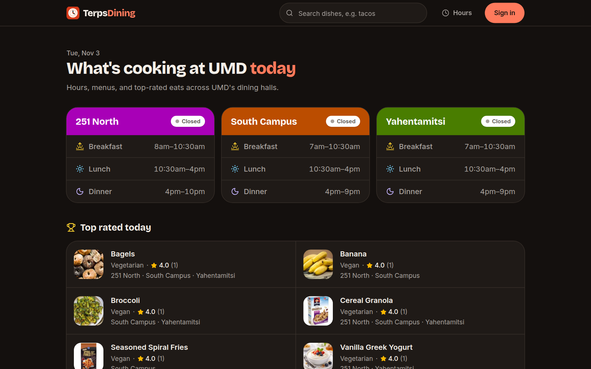

# TerpsDining

[](https://github.com/sbharga/terpsdining/actions/workflows/ci.yml)

TerpsDining shows menus, hours, nutrition, and ratings for the University of Maryland's dining halls. Visit [terpsdining.app](https://terpsdining.app).



## Features

- Menus by dining hall, meal, and station, with diet and allergen filters.
- Hours for every hall, with live open status.
- Search across every dish, including serving history.
- Nutrition facts and a plate calculator.
- Google sign-in for 1–5 star ratings and favorites.

## Quick start

Requires [Bun](https://bun.sh).

```sh
bun install --frozen-lockfile
cp .env.example .env.local
```

Fill in `VITE_SUPABASE_URL` and `VITE_SUPABASE_PUBLISHABLE_KEY` in `.env.local` with the values for a Supabase project that uses the schema in `supabase/migrations/`. Use only the publishable key here, never a secret key.

```sh
bun run dev
```

Open http://localhost:5173. The scraper is optional; see [docs/scraper.md](docs/scraper.md).

## Scripts

| Command | Description |
| --- | --- |
| `bun run dev` | Start the Vite dev server. |
| `bun run build` | Type-check, build, and prerender pages into `dist/`. Needs network access. |
| `bun run lint` | Run oxlint and the design-token check. |
| `bun run typecheck` | Type-check the project. |
| `bun run test` | Run unit tests with Vitest. |
| `bun run preview` | Serve the production build locally. |
| `bun run db:types` | Regenerate `src/lib/database.types.ts` from Supabase. |

## Project structure

```text
src/             React app: pages, components, shared logic in lib/, React Query in api/
scripts/         Prerender script and design-token check
scraper/         Python scraper for hours, menus, nutrition, and food images
supabase/        Database migrations
docs/            Design, data sources, scraper, deployment, and contributing docs
```

## Documentation

- [Design system](docs/design.md)
- [Data sources](docs/data-sources.md)
- [Scraper](docs/scraper.md)
- [Deployment](docs/deployment.md)
- [Contributing](docs/CONTRIBUTING.md)
- [Security policy](docs/SECURITY.md)
- [AGENTS.md](AGENTS.md) for coding agents

## Disclaimer

TerpsDining is an independent project and is not affiliated with UMD. Menus and hours can change. Confirm allergens, ingredients, and cross-contact risks with dining staff before eating. Filters do not establish that food is safe for an allergy. Food images are illustrative, not official dining hall photos. Dates and hours use America/New_York.

## License

The source code is [MIT](LICENSE) licensed. The license covers the code only. Dining data, nutrition labels, and food images belong to their respective sources and are not licensed by this project. Questions: hello@shreyas.com.
